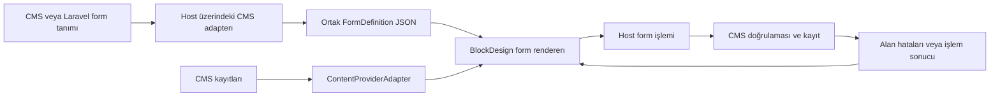

# CMS kaynaklı form altyapısı

14 Ekim 2026 · Durum: ortak sözleşmeler, runtime, editör paneli, HTTP adapter’ları, demo CMS ve yerel veri geçişi uygulandı. [Uygulama ve host entegrasyonu](CMS-FORM-ENTEGRASYONU.md). Laravel/Filament örneği hazır; PHP/Composer bulunmadığı için burada PHP testleri çalıştırılmadı.

## 1. Kararlaştırılan kapsam

Formun alanlarını, alan türlerini, sırasını, etiketlerini, zorunluluklarını ve seçeneklerini CMS tanımlar. BlockDesign bu tanımı okuyup seçilen tasarım sistemiyle formu üretir. CMS’ye veya Laravel’de seçilecek form üretim paketine çekirdek bağımlılığı kurulmaz.

Laravel tarafında otomatik form üretim paketlerinden yararlanılacak. Paket seçimi henüz yapılmadı. Seçilecek paketin tanımı bir Laravel adapter’ı üzerinden ortak JSON sözleşmesine çevrilecek. Her paketin aynı dışa aktarma veya bağımsız istemci desteğini sunduğu varsayılmaz; seçimden önce küçük bir entegrasyon denemesi yapılır.

Her CMS formu veya her alan için yeni katalog bloğu oluşturulmaz. Katalogda bir **CMS formu** bileşeni bulunur. Farklı sayfalara eklenen örnekler farklı `formRef` kullanabilir. Gerçekten farklı görünümler tasarım varyantıdır; tur talebi, transfer talebi ve iletişim aynı görünüme sahipse üç ayrı blok değildir.

İlk sürümün hedefi: Laravel’den veya sahte bir CMS adapter’ından gelen form tanımı → aynı sözleşme → mevcut tasarımla üretilen alanlar → CMS’ye doğrulanmış gönderim. Arama formu yönlendirmesi ayrı bir işlem türüdür.

## 2. Uygulama öncesindeki durum ve eksikler

- `ContentProviderAdapter`, koleksiyon şeması, kayıt arama/seçme ve sorgu için mevcut salt okunur sözleşmedir. Seçenek listelerini beslemek için yeniden kullanılabilir.
- `FieldDefinition` editörün blok içeriğini DOM’a eşler. Ziyaretçi formunun alan tanımı için doğrudan kullanılmayacak; bu iki alan modelinin görevleri farklıdır.
- İçe aktarılan HTML formları şu anda içerik bloklarıdır. Ortak, CMS kaynaklı ziyaretçi formu renderer’ı yoktur.
- `scalanova-runtime.ts` demo form gönderimini durdurur; gerçek gönderim yapmaz. Tur araması için kaynak HTML’ye bağlı yönlendirme vardır.
- Form şeması sürümü, uzak seçenek yükleme, bağımlı alanlar ve standart gönderim/alan hatası sözleşmeleri henüz uygulanmadı.

Yerel formlar yedekli geçişle ortak bileşene taşındı; şema kaynağı demo CMS’dir. Gerçek CMS’ye ait endpoint ve registry uygulaması host projesinde sağlanır. Aşağıdaki mimari kararlar tasarım başvurusudur; uygulama sınırları entegrasyon rehberinde belirtilir.

## 3. Veri akışı ve sorumluluklar



| Parça | Sorumluluk |
|---|---|
| CMS / Laravel | Formun iş anlamı, alanları, doğrulama, kullanılabilir seçenekler ve verinin kaydedileceği yer |
| Laravel paket adapter’ı | Seçilen paketin form tanımını ortak sözleşmeye dönüştürmek; sonuçları ve hataları standartlaştırmak |
| Form provider | Sürümü belli form tanımını ve desteklenen özellikleri sunmak |
| Mevcut content provider | Büyük, aranan veya başka alanın değerine bağlı seçenek kaynaklarını okumak |
| Renderer ve tasarım sistemi | Alan türlerini tasarım parçalarıyla üretmek; label, hata, yardım ve gönderim durumlarını göstermek |
| Form action adapter | Gönderim veya arama işlemini host uygulamaya iletmek |
| Sayfa / şablon | Form referansı, görünüm tercihi ve izin verilen sayfa bağlamını tutmak |

Editörün şemayı okuma erişimiyle yayımlanmış formun ziyaretçi erişimi ayrı yürütme bağlamlarıdır. Editör erişim bilgisi yayımlanmış sayfaya aktarılmaz.

## 4. Önerilen sözleşmeler

Aşağıdaki public API, `packages/contracts/src/forms.ts` içinde uygulanmıştır. Tam alanlar ve çalışma sınırları entegrasyon rehberinde bulunur.

### FormDefinition

- `ref`: CMS içinde kalıcı form kimliği ve değişmez şema sürümü.
- `label`, `locale`: formun gösterim adı ve etiketlerin çözüldüğü dil.
- `fields`: kararlı `fieldId`, tür, sıra, label, yardım, placeholder ve açık başlangıç değeri.
- `validation`: taşınabilir kısıtlar; zorunluluk, uzunluk, sayısal aralık ve açık seçenek üyeliği.
- `options`: küçük sabit değerler veya `ContentProviderAdapter` üzerinden çözülen kaynak tanımı.
- `layout`: grup ve sütun önerileri. CMS CSS veya çalıştırılabilir kod sağlamaz.
- `action`: host tarafından bilinen işlem kimliği ve `submit` / `search` türü.
- `capabilities`: bu tanımın gerektirdiği özellikler. Desteklenmeyen alan türü yayın öncesi açık hata üretir.

İlk alan türleri: `text`, `email`, `tel`, `textarea`, `number`, `date`, `select`, `radio`, `checkbox`. Editör alan türlerinden bağımsız bir `FormFieldType` kullanılır. Dosya yükleme, ödeme, şifre ve çok adımlı form ilk dilime dahil değildir.

```ts
interface FormProviderAdapter {
  readonly providerId: string;
  readonly capabilities: Capability;
  listForms?(context?: RequestContext): Promise<PageResult<FormSummary>>;
  getDefinition(ref: VersionRef, context?: RequestContext): Promise<FormDefinition>;
}

interface FormBinding {
  providerId: string;
  formRef: VersionRef;
  appearance: string; // Örneğin stacked veya inline-search.
  contextBindings: FormContextBinding[];
}

interface FormActionAdapter {
  readonly adapterId: string;
  readonly capabilities: Capability;
  execute(input: FormActionRequest, context?: RequestContext): Promise<FormActionResult>;
}
```

`FormActionRequest`: provider/form/sürüm referansı, `fieldId` ile anahtarlanmış ziyaretçi değerleri, gerekli bağlam ve tekrar gönderim kimliği. CMS’nin gerçek kolon veya request alan adlarına dönüşüm adapter’da yapılır.

`FormActionResult`: ayrık sonuç türü; `accepted` (makbuz veya başvuru kimliği), `validationError` (`fieldId` → mesajlar), `schemaChanged` veya `redirect` (host politikasından geçmiş URL). Bağlantı ve sunucu hataları mevcut adapter hata modeliyle iletilir. E-posta teslimi gibi sonraki işlerin tamamlandığı yalnızca başvurunun kabul edilmesinden çıkarılmaz.

## 5. Örnek: CMS’de tanımlanan seyahat talebi

| Alan kimliği | Tür | Tanımı sağlayan yer |
|---|---|---|
| `full-name` | text, zorunlu | CMS form şeması |
| `email` | email, zorunlu | CMS form şeması |
| `destination` | select | CMS destinasyon koleksiyonu; etiket ve kayıt kimliği eşlemesi |
| `tour` | select | Seçilen destinasyona bağlı CMS tur koleksiyonu |
| `travel-date` | date | CMS’nin yayımladığı tarih kısıtları |
| `guests` | number | CMS’nin yayımladığı kişi sınırları |
| `message` | textarea | CMS form şeması |

Sayfa editörü bu alanları tek tek oluşturmaz. “CMS formu → Seyahat talebi” seçer. Renderer formu üretir; seçilen görünüm mevcut label, input, select, yardım ve hata stillerini uygular. CMS’de etiketi değiştirmek yeni katalog bloğu üretmez.

Tur sayfasındaki tur kimliği izin verilen bir sayfa bağlamı eşlemesiyle forma aktarılabilir. Bağlam ziyaretçi tarafından değiştirilebilen bir girdi gibi değerlendirilir; CMS varlık ve yetki doğrulamasını sunucuda yapar. Kişiye özel başlangıç değerleri sayfa belgesine gömülmez.

## 6. Seçeneklerin yüklenmesi

Mevcut content provider kayıtları `recordId` / değer ve label alanına açık eşlemeyle seçeneklere çevrilir. Kaynak şeması ve capability’leri doğrulanır; her koleksiyonun keyfi sorguyu desteklediği varsayılmaz.

- Küçük enum: tanım içinde açık değer/etiket çiftleri.
- Büyük koleksiyon: arama, cursor ve sınırlı sayıda sonuç. Seçili kimliğin etiketi ayrıca çözülebilir.
- Bağımlı alan: örneğin destinasyon değişince tur değeri temizlenir, yeni seçenekler yüklenir ve eski isteğin sonucu uygulanmaz.
- Desteklenmeyen filtre veya gereken pagination mevcut sözleşmeyle ifade edilemiyorsa capability açıkça yetersiz sayılır; sözleşme kontrollü genişletilir veya host hazır seçenek kaynağı sunar.
- Yükleme hatası boş liste gibi gösterilmez. Hata, yeniden deneme ve gönderim kısıtı görünürdür.
- Etiketler locale’ye göre gelir; kayıt kimliği dil değişince kendiliğinden başka kayda dönüşmez.
- Gönderimde seçeneğin güncel olarak geçerli olup olmadığını CMS yeniden doğrular.

## 7. Kalıcılık ve şema değişikliği

Sayfaya yalnızca `FormBinding`, görünüm ve izin verilen sabit bağlam eşlemeleri kaydedilir. Ziyaretçinin ad, e-posta, mesaj veya anlık alan değerleri `manualData`, `projectData` veya tarayıcı kalıcı çalışma alanına yazılmaz.

Form tanımı, blok tasarım sürümünden bağımsız bir şema sürümüne sahiptir. Yayımlanan form belirli bir şema sürümüne bağlanır. CMS yeni alan eklediğinde veya zorunluluğu değiştirdiğinde editör farkı gösterir; değişiklik sessizce mevcut yayına uygulanmaz. CMS, kullanımda olan eski şemayı hizmette tutmalı veya açık `schemaChanged` sonucu vermelidir.

Yayın sırasında form tanımının kişisel veri ve sır içermeyen anlık kopyası yayın çıktısına alınabilir. Bu, belgeye gömülen ziyaretçi verisi değildir. Seçeneklerin güncelliği ve sürüm ömrü host politikasıyla belirlenir. Editörde kullanılan şema önbelleği provider + form + sürüm + locale + host bağlamına göre ayrılır; kişiye özel önbellek paylaşılmaz.

Etiket değişikliğinde kararlı `fieldId` korunur. Alan silinince, türü değişince veya seçenek kaynağı değişince fark raporlanır; eski değeri başka bir alana tahminle taşıma yapılmaz.

## 8. Laravel entegrasyonu

Laravel tarafında seçilecek form üretim paketinin alan ve doğrulama tanımı tek kaynak olur. BlockDesign için ayrıca aynı formu elle JSON olarak yazma zorunluluğu oluşturulmaz. Paket adapter’ı ortak şemayı üretir; paketin tarayıcı bileşenleri veya yaşam döngüsü BlockDesign’ın içinde çalıştırılmaz.

Başlangıç için host route örnekleri:

```text
GET  /editor/forms
GET  /editor/forms/{id}/versions/{version}
POST /public/forms/{id}/versions/{version}/submissions
```

Bu URL’ler öneridir; çekirdek sabit route, Go sunucusu veya Laravel isimlendirmesi beklemez. Katalog ve şema okuma için editör yetkisi, ziyaretçi gönderimi için host’un oturum ve form erişim kuralları uygulanır. Uzak CMS erişim anahtarları Laravel/host sunucusunda kalır.

Laravel adapter’ı:

1. Paketin desteklediği alan türlerini ve sunucu doğrulamasını ortak form şemasına çevirir.
2. İstemcide ifade edilemeyen iş kuralını sunucuda uygular; kuralı sessizce kaldırmaz veya tarayıcıda keyfi kod olarak çalıştırmaz.
3. Alan kimliğiyle paketin gerçek request anahtarı arasındaki eşlemeyi yapar.
4. Hata mesajlarını kararlı `fieldId` ile geri döndürür; forma ait genel hatayı ayrıca taşır.
5. Kaydı, tekrar gönderim kontrolünü ve başvuru sonrasındaki işleri yönetir.

Paket seçimi için entegrasyon denemesi: tanımdan şema üretme, bağımlı select, sunucu hatası eşleme ve kendi frontend bileşenlerine bağımlı olmadan gönderim. Bu deneme tamamlanmadan belirli bir paketin eksiksiz uyumlu olduğu iddia edilmez.

## 9. Editör, önizleme ve yayın

Editörde işlem sırası: **Form kaynağı → CMS formu → Görünüm → Bağlam eşlemeleri**. Alanları CMS belirlediği için bu ekranda ikinci bir form oluşturucu açılmaz. Şema özeti, sürüm, seçenek kaynakları ve bağlantı durumu gösterilir.

Tasarım parçaları `form`, `field`, `label`, `help`, `error`, `actions` yuvalarına ayrılır. Alan türü bu parçalardan üretilir. Alan grupları ve sütun önerileri yalnızca desteklenen tasarım kuralları içinde uygulanır.

- Düzenleme tuvalinde gerçek başvuru gönderilmez.
- Önizleme varsayılan olarak sahte action adapter kullanır; gerçek gönderim ancak host’un açık test modu ile mümkündür.
- Yayımlanmış embed, host’un enjekte ettiği provider/action adapter’larıyla çalışır.
- Statik HTML export’ta fonksiyon/closure serileştirilmez. Ortak form runtime’ı, sabitlenmiş şema ve host’un açık HTTP bağlantı ayarları gerekir. Bu bağlantı sağlanmadıysa formun gönderemeyeceği görünür biçimde raporlanır; çalışan form diye sunulmaz.

Üretimdeki form POST isteğini bir tarayıcı-local taslağa düşüren offline fallback bulunmaz. Ağ hatasında başarılı mesajı veya otomatik tekrar gönderim yapılmaz. Aynı gönderimin tekrar denenmesi sunucunun tanıdığı aynı işlem kimliğini kullanır.

## 10. Uygulama sırası ve kabul ölçütleri

| Dilim | Çıktı | Kabul ölçütü |
|---|---|---|
| 1. Ortak sözleşme | Form tanımı, binding, action sonuçları; sahte CMS adapter’ı | Aynı şema farklı sağlayıcılardan okunur; bozuk veya desteklenmeyen tanım açık hata verir |
| 2. Renderer ve editör | Tek CMS formu bileşeni, temel alanlar, görünüm eşlemesi | Aynı blok iki farklı form referansıyla çalışır; CMS alan ekleyince yeni blok üretilmez; label, yardım, hata ve klavye sırası tutarlıdır |
| 3. CMS seçenekleri ve Laravel denemesi | Sabit/uzak seçenekler, destinasyon → tur bağımlılığı, bir paket adapter’ı | Eski yanıt yeni seçimi ezmez; gerçek Laravel şeması ve alan hataları doğru eşlenir |
| 4. İşlem ve yayın | Host gönderimi, şema sürümü, embed ve export bağlantısı | Başarılı/başarısız/timeout/tekrar deneme ayrıdır; iki kez kayıt oluşmaz; sır ve ziyaretçi değeri sayfa belgesine girmez |

Mevcut Türkçe HTML formları ilk iki dilim tamamlandıktan sonra görünümler için referans alınır; CMS tanımına bağlanarak taşınır. Mevcut bağımsız form blokları, bunları kullanan sayfa/şablonlar taşındıktan ve referans denetiminden sonra katalogdan kaldırılır. Önceden forma benzeyen ama yalnızca arama yapan yapı gönderim formuna dönüştürülmez.

Önerilen geliştirme hedefi: önce sahte bir CMS’den **İletişim** ve **Seyahat talebi** tanımını tek bileşenle üretmek. Ardından aynı sözleşmeyi değiştirmeden Laravel adapter’ını bağlamak.

## 11. Kodda açılacak noktalar

| Yer | Planlanan değişiklik |
|---|---|
| `packages/contracts` | Form tanımı, alan ve seçenek sözleşmeleri, binding, provider/action port’ları |
| `packages/core` | Şema doğrulama, başlangıç değerleri, bağımlı alan çözümleme ve şema farkı; framework bağımsız |
| Form runtime modülü | Alan üretimi, DOM olayları, geçici ziyaretçi durumu, hata ve yükleme durumları; editör bağımsız kullanılabilir |
| `packages/grapesjs-bridge` | Aynı runtime’ın iframe içine kurulması; update/destroy temizliği |
| `packages/editor` | Kaynak/form/görünüm seçimi, şema farkı ve yayın bağlantısı raporları |
| `packages/adapters` | Ortak HTTP form provider ve action adapter’ları; route/auth enjekte edilir |
| `examples/laravel` | Seçilecek paketin dönüştürücüsü, route/controller örneği ve alan hatası eşlemesi |
| `apps/demo` | Sahte CMS tanımları ve gönderim yapmayan önizleme; Türkçe formların taşınması |

Go referans sunucusuna üretim formu saklama sistemi kurmak ilk uygulama için zorunlu değildir. Host kendi CMS’sini kullanabilmelidir.
